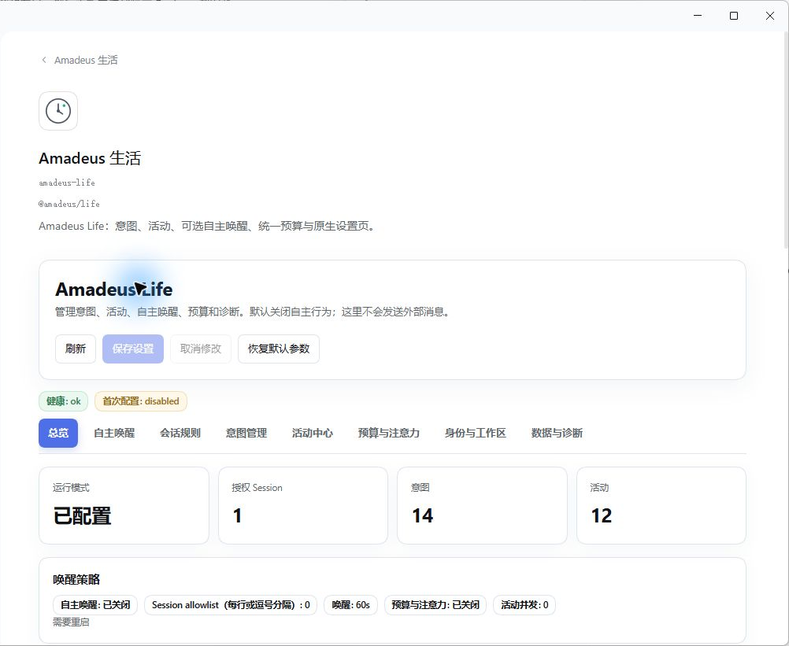

# Amadeus Life

[简体中文](README.zh-CN.md) · [Detailed configuration](REFERENCE.md) · [Issues](https://github.com/jeskoky-pixel/amadeus-life/issues)

Workspace-level autonomous activity, intentions and wake budgets.

Target package: **`@fg-lab/amadeus-life@1.2.1`**. Tested runtime baseline: official DSH Desktop **0.2.1-rc.3**. MIT licensed.

## Release status

Productization candidate. Public npm and GitHub Release publication are pending release gates and npm account authorization. A version in this README is not evidence of publication. See [publishing policy](docs/PUBLISHING.md).

## What you can do

- Track intentions and completed activity across a bound Workspace.
- Define controlled wake rules with budgets, rate limits and execution boundaries; inspect activity history before enabling delivery.
- Recognize trusted ordinary and QQ Session identities, including supported legacy IDs, without taking over QQ's immediate conversation loop.
- Configure rules and inspect state in the plugin's dedicated native DSH settings panels.

Example: record a follow-up intention and set a bounded wake rule for an authorized Workspace. Review delivery state and budget use in the activity view.

Life is a scheduler, not a separate language model. External actions still require the appropriate tools and authorization. Optional QQ, Memory, State and Persona integrations do not grant additional permissions. Keep wake delivery disabled until rules and targets are reviewed.

## Install and configure

Install the prebuilt `.tgz` with the official DSH plugin manager into your selected Profile. No local source build is required. Follow [installation instructions](docs/INSTALL_V1_2.md); do not copy configuration into a running Profile by hand.

Use native DSH settings to bind a Workspace, configure rules and budgets, then explicitly enable wake delivery.

The other Amadeus plugins are optional. Install only the integrations you need.

## Interface

This is a recorded interface screenshot, not evidence that every real platform capability passed the current release gate. See the detailed reference and verification reports for limitations.

## Upgrade and recovery

Back up user data before upgrading. Code, persistent user data and recovery backups are separate. Disable stops functionality; uninstall is intended to retain external data. Restoring old code alone does not reverse a database migration.

- [Upgrade policy](docs/UPGRADE_POLICY.md)
- [Data migration and recovery](docs/DATA_MIGRATION.md)
- [Release checklist](docs/RELEASE_CHECKLIST.md)
- [Full configuration and limitations](REFERENCE.md)

## Ecosystem and license

[Amadeus project](https://github.com/jeskoky-pixel/Amadeus-dsh) · [MIT license](LICENSE)
